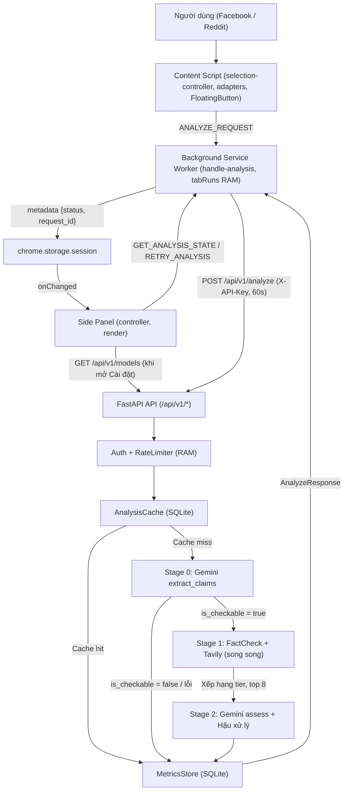

# ARCHITECTURE

Tài liệu mô tả kiến trúc hệ thống, hợp đồng API, quy tắc pipeline, lưu trữ dữ liệu và ranh giới phụ thuộc của TrustMeBro.

Cập nhật: 19/11/2026.

## Tổng quan

TrustMeBro dùng mô hình Client–Server gồm Chrome Extension Manifest V3 (`extension/`) và backend FastAPI (`backend/`). Extension thu nhận văn bản trên Facebook và Reddit, gửi yêu cầu qua HTTP và hiển thị kết quả theo từng tab trên Side Panel. Backend giữ toàn bộ khóa API bên thứ ba, kiểm tra xác thực, áp dụng rate limit, tra cache SQLite, điều phối pipeline 3 giai đoạn và lưu số liệu vận hành. Extension viết bằng TypeScript `strict` với DOM thuần; backend dùng Python, FastAPI, Pydantic v2, `httpx`, `google-genai` và SQLite.

## Sơ đồ ngữ cảnh và luồng phân tích



## Thành phần hệ thống

| Thành phần                  | Đường dẫn                                                                                        | Trách nhiệm                                                                                                                                                         |
| --------------------------- | ------------------------------------------------------------------------------------------------ | ------------------------------------------------------------------------------------------------------------------------------------------------------------------- |
| Content Script & Adapters   | `extension/src/entrypoints/content.ts`, `extension/src/features/analysis/content/`               | Bắt bôi đen 20–2000 ký tự trên Facebook/Reddit (debounce 150ms), hiện nút nổi trong closed Shadow DOM, chèn nút bài viết ở trang `/comments/` Reddit                |
| Background Worker           | `extension/src/entrypoints/background.ts`, `extension/src/features/analysis/background/`         | Nhận message, mở Side Panel, giữ trạng thái đầy đủ trong RAM `tabRuns`, gọi `/api/v1/analyze`, chuẩn hóa response và xóa state khi đóng/điều hướng tab              |
| Side Panel UI               | `extension/src/entrypoints/sidepanel/`, `extension/src/features/analysis/sidepanel/`             | Render 4 trạng thái (`idle`, `loading`, `success`, `error`), tải lười `/api/v1/models`, hiển thị giải thích đánh dấu, nguồn, chia sẻ và khung feedback              |
| Extension Shared & Infra    | `extension/src/shared/`, `extension/src/infrastructure/`, `extension/src/features/analysis/*.ts` | Hợp đồng message, HTTP client (`60s` timeout), wrapper `chrome.storage.session`, parser đánh dấu, lọc URL, tóm tắt chia sẻ, lưu model ưu tiên                       |
| FastAPI App & Auth          | `backend/app/main.py`, `backend/app/api/deps.py`                                                 | Lifespan dùng chung HTTP/Gemini client, security headers, giới hạn body, CORS, xác thực `X-API-Key` / `X-Admin-API-Key`, trích IP proxy                             |
| API Routes                  | `backend/app/api/v1/analyze.py`, `backend/app/api/v1/metrics.py`                                 | Cung cấp `/analyze`, `/models`, `/feedback`, `/stats/summary`; phối hợp cache, rate limit và ghi metrics                                                            |
| Orchestrator                | `backend/app/orchestrator/analysis_orchestrator.py`                                              | Chạy pipeline 3 giai đoạn dưới ngân sách thời gian đơn điệu, áp quy tắc dừng sớm, ưu tiên FactCheck và ràng buộc nhất quán                                          |
| External Services & Prompts | `backend/app/services/`, `backend/app/prompts/gemini_prompts.py`                                 | Gọi Gemini Interactions API (kèm `GeminiModelPool`), Google Fact Check Tools API, Tavily Search API qua `BaseService` và `@safe_execute`                            |
| Core & Storage              | `backend/app/core/`                                                                              | Cấu hình (`config.py`), rate limiter RAM, JSON logging, SQLite (`metrics.py`, `analysis_cache.py`), xếp hạng tên miền (`source_ranking.py`, `trusted_domains.json`) |
| Benchmark                   | `scripts/benchmark/run_benchmark.py`                                                             | Đánh giá 3 chế độ (`llm_only`, `llm_factcheck`, `full`) trên bộ CSV, cache resume và xuất `report.md`, `raw.csv`, `chart.png`, `summary.json`                       |

## Hợp đồng API

| Endpoint                    | Xác thực          | Rate limit                                  | Phản hồi chính / Mã lỗi                                           |
| --------------------------- | ----------------- | ------------------------------------------- | ----------------------------------------------------------------- |
| `GET /health`               | Không             | Không                                       | `200` `{"status": "ok"}`                                          |
| `GET /api/v1/models`        | `X-API-Key`       | Không                                       | `200` `{default_model, models}`; `401`, `500`                     |
| `POST /api/v1/analyze`      | `X-API-Key`       | IP/phút, Key/ngày (miss cache), Global/ngày | `200` `AnalyzeResponse`; `401`, `413`, `422`, `429`, `500`, `503` |
| `POST /api/v1/feedback`     | `X-API-Key`       | Dùng chung IP, Key, Global với `/analyze`   | `204` (ghi/cập nhật); `401`, `404`, `413`, `422`, `429`, `500`    |
| `GET /api/v1/stats/summary` | `X-Admin-API-Key` | Không                                       | `200` thống kê tổng hợp; `401`, `503`                             |

Schema request của `POST /api/v1/analyze` (`backend/app/schemas/request.py`):

- `text`: `str`, bắt buộc, độ dài `20..2000` ký tự sau `strip()`.
- `platform`: `"facebook" | "x" | "reddit"`, bắt buộc.
- `page_url`: `str | None = None`, `lang`: `str | None = None`.
- `model_id`: `str | None = None` (`max_length=100`), phải nằm trong `settings.available_gemini_models` nếu truyền.
- `bypass_cache`: `bool = False`.

Ví dụ `POST /api/v1/analyze` request và response (`backend/app/schemas/response.py`):

```json
{
  "text": "Ngân hàng không bao giờ yêu cầu cung cấp mã OTP qua điện thoại.",
  "platform": "facebook",
  "page_url": "https://www.facebook.com/example/posts/1",
  "lang": "vi",
  "model_id": "gemini-3.1-flash-lite",
  "bypass_cache": false
}
```

```json
{
  "request_id": "550e8400-e29b-41d4-a716-446655440000",
  "verdict": "likely_true",
  "confidence_score": 0.9,
  "explanation": "[[+Cơ quan chức năng xác nhận]] ngân hàng không yêu cầu mã OTP qua điện thoại.",
  "sources": [
    {
      "title": "Cảnh báo lừa đảo mạo danh ngân hàng",
      "url": "https://sbv.gov.vn/canh-bao",
      "publisher": "Ngân hàng Nhà nước Việt Nam",
      "snippet": "Ngân hàng không bao giờ yêu cầu khách hàng cung cấp mã OTP.",
      "stance": "supports",
      "original_stance": null,
      "claim_text": null,
      "published_date": "2026-10-05"
    }
  ],
  "service_status": { "factcheck": "empty", "tavily": "ok", "gemini": "ok" },
  "model_usage": {
    "requested_model": "gemini-3.1-flash-lite",
    "extraction_model": "gemini-3.1-flash-lite",
    "assessment_model": "gemini-3.1-flash-lite",
    "fallbacks": []
  }
}
```

Schema `POST /api/v1/feedback` (`backend/app/api/v1/metrics.py`, `extra="forbid"`): `request_id` (`UUID4`), `helpful` (`StrictBool`), `reason` (`"incorrect_verdict" | "missing_context" | "weak_sources" | "other" | null`). Extension hiện giữ cờ `FEEDBACK_ENDPOINT_ENABLED = false` trong `extension/src/shared/config.ts` vì UI Side Panel dùng schema `{request_id, rating (1..5), comment?}`.

Mã lỗi HTTP: `401` (thiếu/sai key), `404` (không tìm thấy `request_id` có verdict khi gửi feedback), `413` (`Content-Length > MAX_BODY_SIZE_BYTES`), `422` (sai schema hoặc `model_id` không được bật), `429` (vượt rate limit, kèm `Retry-After`), `500` (chưa đặt `EXTENSION_API_KEY` hoặc lỗi nội bộ), `503` (mọi model Gemini cạn quota kèm `Retry-After`, lỗi ghi SQLite metrics khi status `200`, hoặc `ADMIN_API_KEY` chưa đặt/trùng `EXTENSION_API_KEY`).

## Quy tắc ra quyết định của pipeline

Pipeline trong `AnalysisOrchestrator` chạy theo deadline đơn điệu `ANALYSIS_TIMEOUT_SECONDS` (mặc định `25.0s`), với trần mỗi bước AI `stage_cap = max(20.0, ANALYSIS_TIMEOUT_SECONDS * 0.6)`.

1. **Stage 0 (`extract_claims`):** Timeout `min(deadline, now + stage_cap)`, SDK timeout `15s`, tối đa 2 lần thử khi lỗi ngoài `429` hoặc lỗi validate JSON. Trung hòa `[[`/`]]`, bọc đầu vào trong `<post>...</post>`. Nếu lỗi, timeout hoặc rỗng: trả `unverified`, `confidence_score = 0.0`, `service_status.gemini = "error"`. Nếu `is_checkable = false`: dừng sớm, trả `unverified`, `confidence_score = 0.0`, `sources = []`.
2. **Stage 1 (thu thập bằng chứng song song):** Lấy tối đa `min(SEARCH_QUERY_LIMIT, 2)` truy vấn khác rỗng và không trùng (dùng `main_claim` nếu rỗng). Chạy song song mọi cặp `(provider, query)` trong `asyncio.wait(..., timeout=min(remaining, 15.0))`, mỗi service bọc `@safe_execute(timeout_seconds=10.0)`:
   - `FactCheckService`: gọi `claims:search` (`pageSize=10`, kèm `languageCode=ctx.lang`), thử lại 1 lần không `languageCode` nếu rỗng. Ánh xạ `textualRating` theo `RATING_GROUPS` (EN/VI) sang `supports`/`refutes`/`neutral` và khóa `original_stance` (`frozen=True`).
   - `TavilySearchService`: gọi `POST https://api.tavily.com/search` (`search_depth="basic"`, `max_results=5`, `include_published_date=True`, `include_usage=True`), thử `topic="news"` rồi fallback `"general"`. Cắt `snippet` tối đa 300 ký tự.
3. **Gộp, xếp hạng và điều kiện dừng sớm:** Gộp FactCheck trước, Tavily sau, loại trùng theo `url` (giữ bản FactCheck). Xếp hạng theo `backend/app/core/trusted_domains.json` (`tier1` gồm 17 tên miền, `tier2` gồm 15 tên miền, còn lại `default`) và lấy tối đa `8` nguồn. Nếu quá `deadline`: trả `unverified` (`0.0`, gắn `gemini="error"` nếu có nguồn) kèm nguồn đã thu. Nếu rỗng nguồn: trả `unverified` (`0.3`).
4. **Stage 2 (`assess`) và hậu xử lý:** Timeout `min(deadline, now + stage_cap)`, tối đa 2 lần thử. Truyền ngày hiện tại (`Asia/Ho_Chi_Minh`), `claim`, `<post>`, và tối đa 8 nguồn kèm `source_tier`, `published_date`, `source_type`, `claim_text`, `original_stance`. Lọc bỏ URL ngoài tập nguồn; làm sạch đánh dấu `[[+...]]`, `[[-...]]`, `[[?...]]` (tối đa 4 đoạn không lồng, sai cú pháp thì bỏ hết ký hiệu).
   - Cập nhật `stance` từ Gemini chỉ cho nguồn thuộc Tavily (không trùng URL với FactCheck).
   - **Ưu tiên FactCheck:** Chỉ xét nguồn `factcheck_sources[:1]` nếu nằm trong top 8 `sorted_sources`, `assessment.status != "error"`, `claim_text` khác rỗng và Gemini trả `factcheck_match = True`. Khi thỏa mãn và `original_stance` là `supports` hoặc `refutes`, ghi đè verdict thành `likely_true` hoặc `likely_false` và đặt `confidence_score = max(confidence_score, 0.8)`.
   - **Nhất quán điểm tin cậy:** `likely_true` hoặc `likely_false` phải có `confidence_score >= 0.5`; `unverified` giới hạn `confidence_score <= 0.4`.
   - Trước khi trả về, `/analyze` ghi đè `source.publisher` bằng `display_names` từ `trusted_domains.json` nếu khớp tên miền.
5. **Xoay vòng model Gemini (`GeminiModelPool`):** Duyệt vòng tròn trên `available_gemini_models` (`[GEMINI_MODEL, *GEMINI_MODELS]` loại trùng) bắt đầu từ `requested_model`. Model bắt đầu bằng `gemini-3` đặt `{"thinking_level": "low"}`. Chỉ HTTP `429` đưa model vào cooldown `max(GEMINI_QUOTA_COOLDOWN_SECONDS, RetryInfo, Retry-After, thời gian đến nửa đêm America/Los_Angeles nếu quota PerDay)`. Hết toàn bộ model trả `503` + `Retry-After`.

Ánh xạ hiển thị phía Extension (`map-response.ts`): `confidence_score < 0.5` → `Thấp` (1 vạch), `< 0.75` → `Vừa` (2 vạch), `>= 0.75` → `Cao` (3 vạch).

## Lưu trữ dữ liệu

- **SQLite (`METRICS_DB_PATH`, mặc định `backend/data/metrics.db`):**
  - `analysis_metrics`: lưu `request_id`, `created_at`, `platform`, `text_length`, `content_hash` (SHA-256 của văn bản chuẩn hóa NFKC + gộp khoảng trắng), `http_status`, `verdict`, `confidence`, độ trễ từng bước, model, usage, `cache_hit`, `estimated_cost_usd`. Không lưu văn bản gốc hoặc `page_url`.
  - `feedback`: khóa chính `request_id` tham chiếu `analysis_metrics`, lưu `helpful` (`0`/`1`) và `reason`.
  - `analysis_cache`: khóa chính `(content_hash, prompt_version, model_id, lang)` với `content_hash` (SHA-256 lowercase + gộp khoảng trắng), `prompt_version` (SHA-256 của `EXTRACT_CLAIMS_PROMPT` và `ASSESS_PROMPT`), `lang` (SHA-256 của `lang`). TTL mặc định: `86400s` (`confidence >= 0.8`, khác `unverified`), `3600s` (`< 0.8`), `900s` (`unverified`). Không ghi cache khi timeout, có provider `"error"`, `ttl <= 0`, `bypass_cache=true`, hoặc response lặp lại `text`/`page_url`.
- **RAM backend (theo process):** `RateLimiter` (IP/phút, Key/24h, Global/ngày UTC) và `GeminiModelPool` (cooldown model).
- **Trình duyệt (Extension):** RAM Service Worker (`tabRuns` Map) giữ `request`, `response`, `error`, `feedback` và xóa khi đóng hoặc điều hướng tab. `chrome.storage.session` chỉ lưu `{status, request_id?}` (`tabState_<tabId>`) và `geminiModelCatalog`. `chrome.storage.local` chỉ lưu `preferredGeminiModel`.

## Quy tắc phụ thuộc giữa các lớp

- **Extension:** `entrypoints/` → `features/` → `infrastructure/`. `shared/messages.ts` chỉ dùng `import type` từ `features/`. `background/` không import DOM; `content/` không import `background/` hoặc `infrastructure/api/`; `sidepanel/controller.ts` gọi trực tiếp `GET /api/v1/models` qua `backend-client.ts`; `infrastructure/` không import ngược `features/` hoặc `entrypoints/`.
- **Backend:** `api/` → `orchestrator/` → `services/` → `schemas/`, `core/`. Lời gọi HTTP/SDK tới bên thứ ba chỉ nằm trong `services/`.

## Quyết định thiết kế

| Quyết định                                               | Lý do                                                                     | Đánh đổi                                             |
| -------------------------------------------------------- | ------------------------------------------------------------------------- | ---------------------------------------------------- |
| Tách Extension và FastAPI Orchestrator                   | Giữ khóa Gemini, Tavily, FactCheck tại server và tách DOM khỏi logic AI   | Tăng độ trễ mạng và yêu cầu duy trì backend          |
| Dùng TypeScript + DOM thuần cho Extension                | Giữ bundle nhỏ, không dùng `innerHTML`, tránh phụ thuộc framework UI      | Tự quản lý cập nhật DOM trong `render.ts`            |
| Giữ dữ liệu phiên phân tích trên RAM Worker              | Tránh lưu nội dung bài đăng vào `chrome.storage`                          | Mất trạng thái chi tiết nếu Service Worker bị tắt    |
| Dùng SQLite cục bộ cho metrics và cache                  | Không cần dịch vụ cơ sở dữ liệu ngoài ở giai đoạn hiện tại                | Không chia sẻ dữ liệu khi chạy nhiều máy chủ độc lập |
| Xếp hạng nguồn bằng `trusted_domains.json`               | Ưu tiên nguồn cơ quan nhà nước và báo chính thống trước khi đánh giá      | Cần cập nhật danh sách tên miền thủ công             |
| Tắt gửi feedback qua `FEEDBACK_ENDPOINT_ENABLED = false` | Ngăn gửi lỗi `422` khi UI 5 sao lệch schema backend (`helpful`, `reason`) | Chưa thu thập được phản hồi từ Extension             |

## Ràng buộc và giới hạn đã biết

- Rate limiter và cooldown model nằm trong RAM từng process, mất khi khởi động lại và không đồng bộ giữa nhiều worker.
- Extension hiện chỉ khai báo adapter và `host_permissions` cho Facebook và Reddit; nút kiểm chứng toàn bài mới có ở trang `/comments/` của Reddit.
- `VITE_EXTENSION_API_KEY` là khóa tĩnh đóng gói trong bundle extension; chi tiết xem [SECURITY_CHECKLIST.md](SECURITY_CHECKLIST.md).
- `extension/vite.config.ts` đọc `process.env.VITE_BACKEND_URL` trực tiếp khi sinh `manifest.json`; sửa URL chỉ trong `extension/.env` không đổi `host_permissions`.
- Xem danh sách biến môi trường tại [README.md](README.md) và lộ trình khắc phục tại [ROADMAP.md](ROADMAP.md).
